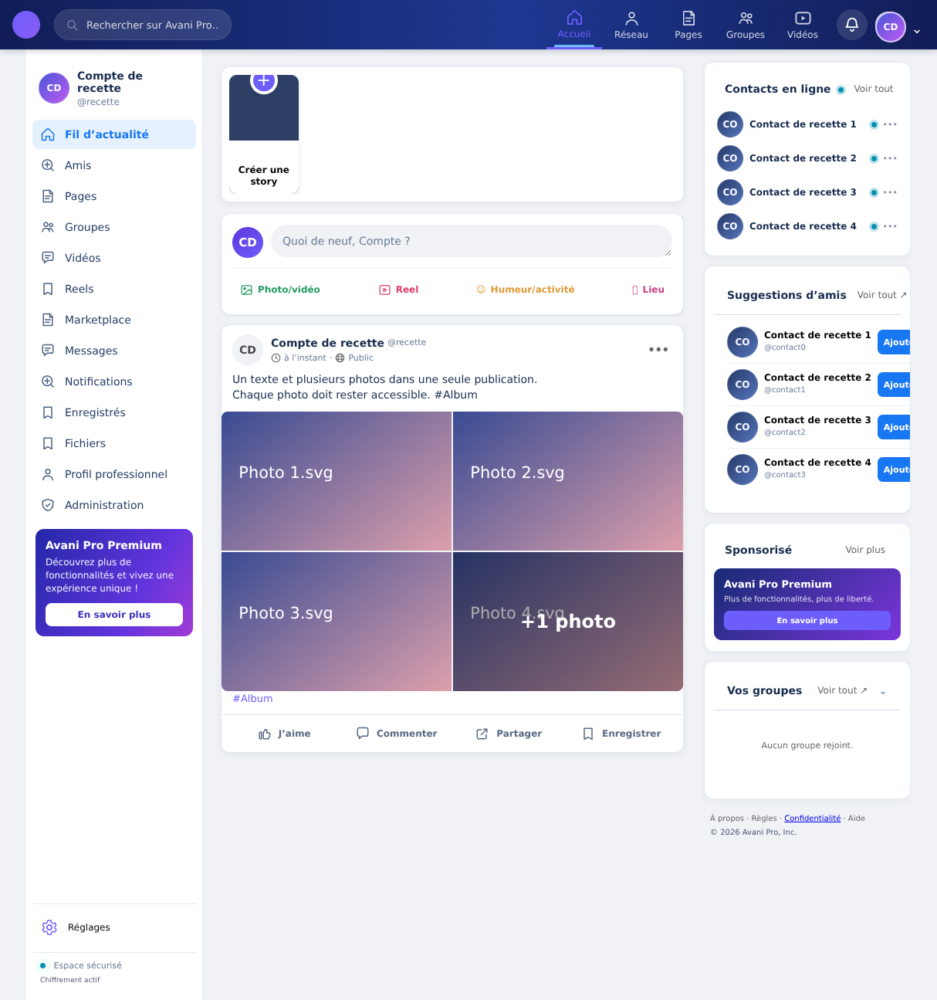
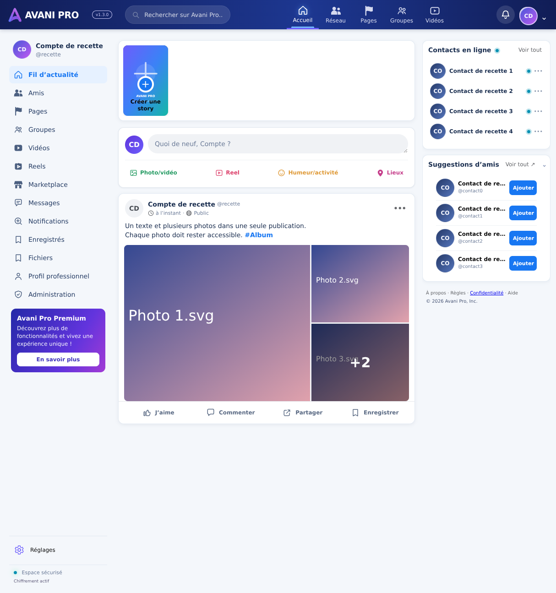
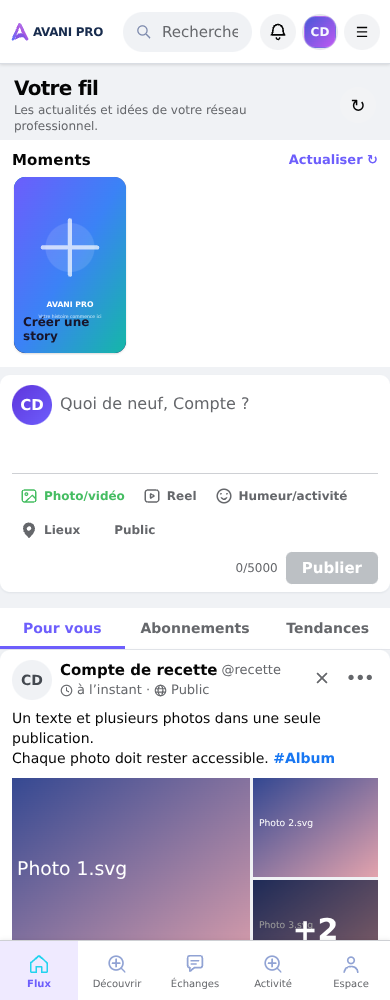

# Fil et albums — comparaison avec la référence

Vérification du 23 octobre 2026. La référence est l’image « Fil Avani Pro _ rêves et inspiration.png » fournie dans la conversation.

## Écarts constatés et corrections

| Élément | Avant | Correction |
|---|---|---|
| Identité en haut | Ancienne règle globale : bouton rond, logo/texte masqués | Wordmark SVG local, version conservée, variante lisible sur mobile |
| Cinq photos + texte | Aperçu 2×2 ; `+1 photo` non navigable | Une grande photo à gauche, deux vignettes à droite ; `+2` ouvrant l’album complet |
| Consultation | Ouverture isolée de quelques images, sans accès aux images restantes | Visionneuse native modale, précédent/suivant, miniatures, clavier, Échap et restauration du focus |
| Publication multiple | Limite de quatre fichiers ; repli silencieux possible sur la première image si le schéma était incomplet | Jusqu’à dix fichiers, ordre conservé ; refus explicite du schéma incomplet, nettoyage des uploads et conservation du brouillon |
| Texte et hashtags | Hashtags répétés sous les images | Texte et hashtags en place, avant l’album, sans duplication |
| Alignement | Plusieurs anciennes grilles `.app-shell.theme-light` écrasaient les points de rupture ; colonne fantôme sur tablette | Suppression de ces grilles concurrentes ; trois colonnes desktop, deux tablette, une mobile |
| Colonne droite | Décalage vertical après redimensionnement ; boutons Ajouter coupés | Conteneur sticky non bloqué par l’overflow du parent ; alignement supérieur commun, texte tronqué sans déborder sur le bouton |
| Assets de navigation | Vidéos = bulle de message, Reels = signet, Amis = recherche | Symboles SVG dédiés, Pages en drapeau ; humeur/lieux en SVG plutôt qu’en caractères dépendant de la police |

Le contenu de la maquette (visages, publications, nombres, commentaires, stories) n’est pas injecté dans les données du site. La fidélité de structure ne signifie pas que des données inexistantes apparaîtront. Le rendu n’est pas présenté comme une reproduction pixel pour pixel.

## Captures du véritable composant App, avec données de recette isolées

Ces captures ne sont **pas des captures de la production**. Les noms « Compte de recette », photos numérotées et réponses Supabase sont des fixtures interceptées uniquement par Playwright. Aucune donnée de production n’a été lue ou écrite par cette recette.

### Avant


### Après, ordinateur 1214 px


### Après, mobile 390 px


## Tests exécutés

- `npm run build` : TypeScript et Vite réussis.
- `npm run test:feed` : **150/150** contrôles.
- `npm run lint` : zéro erreur, 32 avertissements préexistants à cette correction.
- `git diff --check` : propre.
- Patch Vite verrouillé en 8.3.5 : la vulnérabilité haute signalée par l’audit avant cette livraison n’est plus présente ; `npm audit` ne signale aucune vulnérabilité.
- Navigateur Chromium : cinq fichiers sélectionnés et cinq requêtes d’upload ; insertion unique contenant le texte et cinq chemins ordonnés ; relecture après rechargement via API interceptée.
- Navigateur Chromium : `+2`, navigation clavier et tactile par boutons, compteur, Échap, fermeture mobile.
- Navigateur Chromium : simulation de colonne `media_paths` absente ; une seule tentative d’insertion (aucun repli mono-photo), nettoyage de l’objet téléversé, texte et aperçu conservés.
- Largeurs 1214, 1024, 768 et 390 px : absence de débordement horizontal ; deux colonnes réelles sur tablette, sans troisième colonne fantôme ; alignement des premières cartes du fil et de droite sur desktop.

Ces tests ne prouvent pas un upload réel vers Storage, la lecture des octets depuis Supabase ou le rendu sur un téléphone physique. Les autorisations serveur et le transfert réel restent distincts de cette recette UI.

## Rejouer la recette navigateur

Dépendances de test optionnelles, non ajoutées à l’application :

```sh
npm ci
npm install --no-save --package-lock=false playwright-core @sparticuz/chromium
VITE_SUPABASE_URL=https://avani-test.supabase.co \
VITE_SUPABASE_PUBLISHABLE_KEY=browser-test-only \
npm run dev -- --host 0.0.0.0 --port 5173
```

Dans un autre terminal :

```sh
node scripts/browser-feed-check.mjs
```

Le navigateur doit disposer des bibliothèques système NSS/NSPR. Dans le sandbox de recette, elles ont été extraites de l’archive `al2023.tar.br` incluse dans le package Chromium, avec `LD_LIBRARY_PATH` pointant sur son dossier `lib`.

Le serveur de recette utilise une URL Supabase factice ; ne pas le déployer. Playwright intercepte les requêtes uniquement dans son propre navigateur. Arrêter ce serveur après les tests. Captures temporaires dans `.arena/feed-check`, dossier ignoré par Git.

## Suite : nettoyage des doublons

- Une seule promotion Premium, dans la colonne gauche ; suppression du bloc promotionnel répété à droite et du bloc réseau déjà masqué.
- Les groupes rejoints restent dans les raccourcis ; suppression du second bloc affichant exactement ces mêmes groupes à droite.
- Suppression du logo supplémentaire masqué dans la sidebar ; les accès distincts entre navigation ordinateur et mobile sont conservés.
- Déduplication stable des profils, groupes et posts par identifiant, sans modifier les données stockées ni fusionner deux publications distinctes ayant le même texte.
- Les suggestions excluent désormais les personnes déjà suivies.
- Même fichier sélectionné à nouveau : ignoré avant les quotas et avant upload. L’identité est basée sur nom, taille, type et date de modification ; ce n’est pas une comparaison cryptographique des contenus.
- Verrou immédiat de soumission en complément de l’état React : deux événements `submit` consécutifs ne déclenchent qu’un envoi.
- Recette navigateur rejouée : deux sélections successives des cinq mêmes photos donnent toujours cinq aperçus et cinq uploads ; deux soumissions synchrones donnent une seule insertion. Un seul titre Premium est présent dans le DOM.
- Aucun nettoyage destructif en base : aucune publication, photo, personne ou groupe supprimé.
