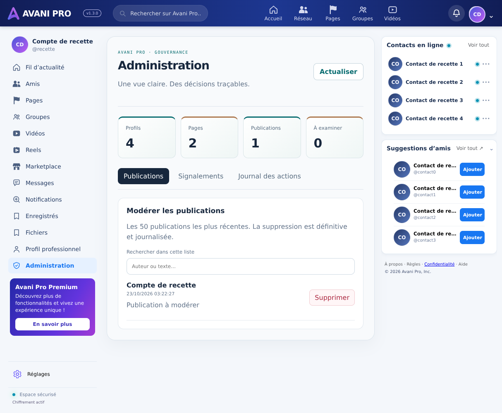

# Réglages, administration et modération — 23 octobre 2026

## Livraison
- Compte : seul le bouton « Se déconnecter » est rouge. Titre, explication et statut restent neutres. Une règle mobile trop générale a été corrigée ; la couleur calculée a été contrôlée dans Chromium.
- Réglages : apparence synchronisée, identité professionnelle, confidentialité/session ; commandes plateforme visibles uniquement aux rôles admin/super_admin. Suppression des interrupteurs email/compact qui ne déclenchaient pas les services annoncés. Les préférences déjà stockées sont conservées lors du changement de thème.
- Nouvelle administration : états chargement/refus/erreur, actualisation, quatre compteurs réels, publications récentes recherchables (limite 50), suppression confirmée, traitement des signalements et journal des vingt dernières actions.
- Suppression des publications : menu disponible à l’auteur et aux administrateurs ; autorisation vérifiée à nouveau par RPC serveur à chaque appel. Un admin ne peut pas modifier le texte d’un autre auteur via cette interface.
- Les administrateurs peuvent modérer toutes les publications ; aucun nouvel accès aux conversations privées ni aucune suppression de comptes n’est ajouté.
- Répondre/modifier/supprimer un message : menu replié, un seul ouvert à la fois, fermeture clavier/perte de focus et confirmation de suppression. Ce n’est pas une copie intégrale de WhatsApp.
- Palette dédiée aux nouveaux espaces : indigo minuit, pétrole minéral, cuivre satiné. Aucune exclusivité mondiale des couleurs n’est revendiquée.

## Serveur
Migration `017_post_moderation.sql` appliquée au projet hpsftpganwkcftnbgnwq (`post_moderation_console`).
Fonctions : `avani_can_moderate`, `avani_delete_post`, `avani_admin_overview`, `avani_resolve_report`.
Droits accordés à authenticated, retirés à anon/PUBLIC ; rôle admin/super_admin lu en base et non dans les métadonnées de l’utilisateur.
Suppression et journalisation font partie de la même transaction. La suppression du post entraîne les cascades de ses relations définies en base. Les objets Storage orphelins ne sont pas purgés automatiquement par cette migration.

## Vérification
- Compilation TypeScript/Vite réussie ; 156/156 contrôles du fil ; lint sans erreur (34 avertissements, dont deux nouveaux avertissements React sur les effets de chargement).
- Recette Supabase sous rôle authentifié avec rollback : tiers refusé à la suppression et à la console ; auteur autorisé ; admin autorisé sur la publication d’autrui ; résolution de signalement ; présence du journal. Aucun post ni rôle réel modifié après rollback.
- Droits anonymes RPC vérifiés : pas de suppression ni de console.
- Recette navigateur avec API interceptée : couleur rouge du seul bouton de déconnexion, réglages sans faux interrupteurs, console et onglets, requête de suppression serveur. Régression albums/doublons et dispositions 1214/1024/768/390 px également réussie.
- Pas de transfert Storage réel ni de tests sur téléphone physique ; la recette navigateur utilise des données isolées, non la production.

Recettes rejouables : `supabase/tests/post_moderation.sql`, `scripts/browser-feed-check.mjs` (installation et environnement décrits dans `feed-reference.md`).
