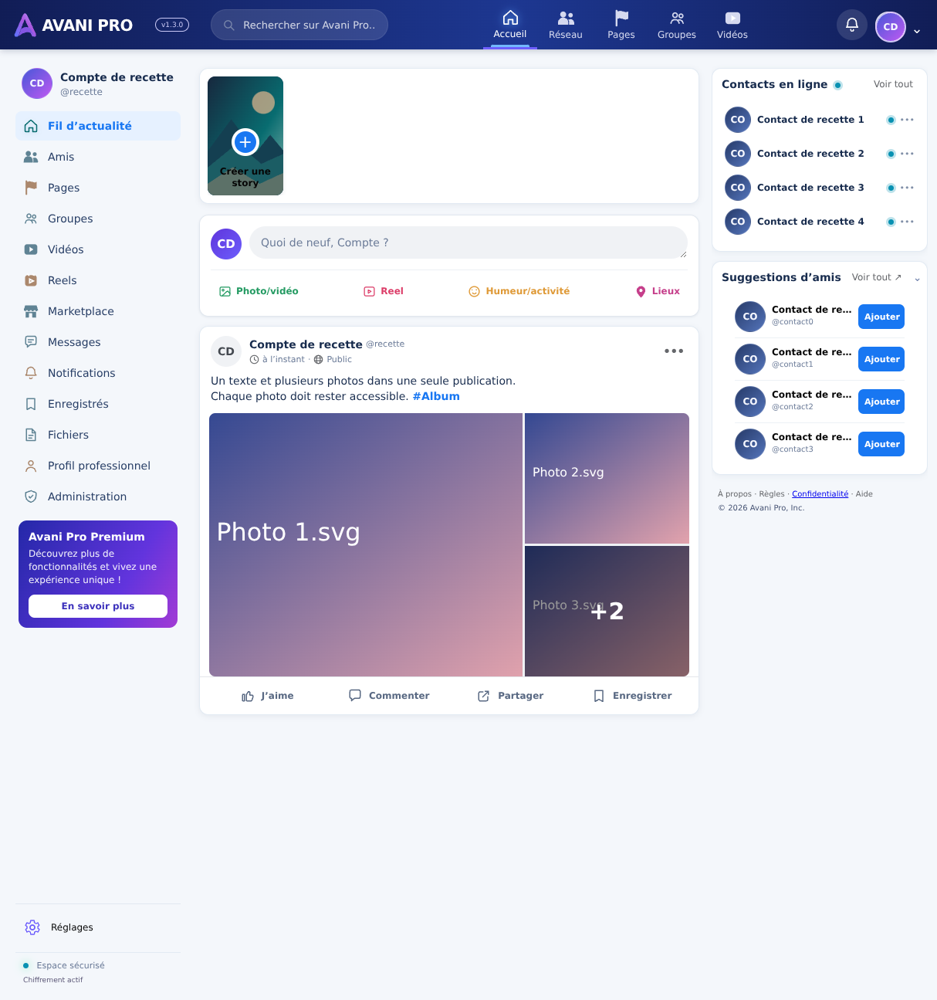

# Assets et publication : premier lot mesuré

## Portée réelle
La demande de 10 000 nouvelles fonctions et 10 000 améliorations n’est pas réalisée par ce lot. Ce document sépare les livraisons effectuées des pistes à prioriser. Aucune promesse de zéro erreur ni de 20 000 changements accomplis.

### Quatre fonctions livrées
1. Récupération automatique du brouillon texte après rechargement dans le même onglet, isolée par compte, durée maximale 24 h.
2. Abandon explicite du brouillon (texte + médias sélectionnés), avec confirmation.
3. Réorganisation des médias avant publication, par boutons accessibles ; l’ordre choisi est celui envoyé au stockage.
4. Publication au clavier : Ctrl+Entrée ou Cmd+Entrée, avec le même verrou contre les doubles soumissions.

Les fichiers ne sont pas sauvegardés dans le navigateur. Ils doivent être resélectionnés après un rechargement. Le texte est en sessionStorage, non envoyé au serveur avant publication ; ce stockage n’est pas chiffré et disparaît à la fermeture de la session d’onglet selon le navigateur. Les brouillons expirés ou corrompus sont ignorés, un stockage bloqué ne fait pas planter le composeur, un enregistrement échoué conserve le brouillon. La réussite ou l’abandon efface le brouillon. Deux comptes ne partagent pas la même clé ; le composeur est remonté lors du changement de compte.

### Doublons identifiés et corrections
- Story : suppression du « + » et des libellés intégrés dans le fond SVG. L’interface conserve son seul bouton « + » et son libellé. Le fond devient un paysage abstrait.
- Notifications : icône dédiée, partagée par le bouton supérieur et les entrées de navigation, au lieu de réutiliser celle de recherche.
- Fichiers : icône de document, au lieu de réutiliser celle des éléments enregistrés.
- Vidéos : le bouton de navigation réutilise le sprite commun plutôt que dupliquer son SVG en ligne.
- L’audit ne trouve aucun fichier d’image strictement identique dans les 26 assets. Les variantes de couleurs utiles (logo clair/sombre) ne sont pas supprimées. Une capture utilisateur reste nécessaire pour identifier les autres répétitions visuelles éventuelles.

### Contrôles ajoutés
- `npm run test:assets` : contrôle des fichiers image identiques, identifiants SVG répétés dans un fichier et références littérales d’icônes. 26 fichiers et 31 références vérifiés. Ce n’est pas un comparateur perceptuel et il ne couvre pas les références calculées dynamiquement.
- GitHub Actions : compilation, lint, audit des assets et tests de régression sur les PR et sur main. Configuration ajoutée ; son exécution distante reste à confirmer.

## Vérifications locales
- Build TypeScript/Vite réussi.
- 167/167 contrôles du fil ; 4/4 contrôles de durcissement ; audit des assets réussi.
- Lint : aucune erreur, 34 avertissements conservés.
- Chromium : restauration après rechargement, vidage puis absence de restauration, réorganisation des médias, publication au clavier. Régression des albums/doubles soumissions et des espaces professionnels également réussie.
- Quatre largeurs : 1214, 1024, 768 et 390 px.
- Les réponses Supabase sont interceptées dans ces tests navigateur. Pas de transfert réel vers Storage ni de test sur téléphone physique dans cette recette.

## Lots suivants proposés, non implémentés

| Chantier | Exemples à définir | Conditions de livraison |
|---|---|---|
| Messagerie | recherche dans un fil, gestion des non-lus, épinglage | droits serveur, reprise réseau et deux comptes/appareils |
| Publications | pagination, filtres persistants, meilleure gestion des médias incompatibles | conservation des données, tests upload/relecture réels |
| Administration | pagination serveur, motifs de modération, export d’audit | contrôle des rôles à chaque action, absence de données privées indues |
| Accessibilité | navigation clavier des menus, contraste, lecteur d’écran | parcours complet clavier et audits ciblés |
| Performance | tailles d’images adaptées, chargement différé, suivi des erreurs | mesures avant/après et absence de régression |
| Premium | définir les véritables avantages et droits administrateurs | modèle d’autorisation serveur avant toute promesse d’accès |

Chaque lot doit contenir des besoins distincts, des critères d’acceptation et une recette. On ne compte pas les lignes de code, changements de couleurs ou tests comme des milliers de fonctionnalités.
